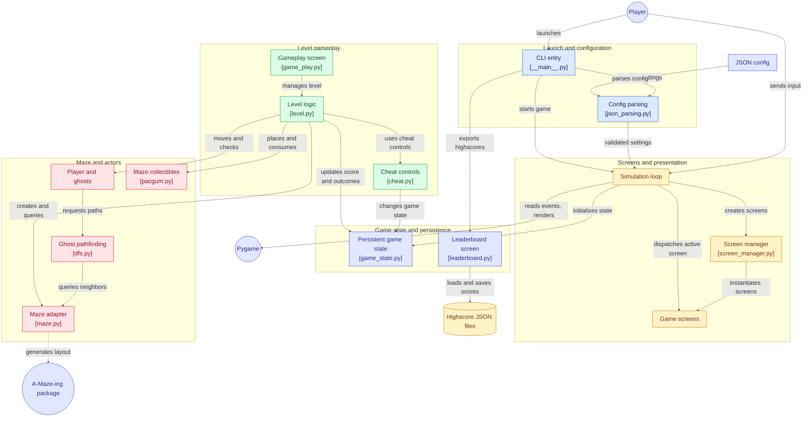

*This project has been created as part of the 42 curriculum by nmontard, adamez-f.*

# Pac-Man

## Table of Contents
- [Pac-Man](#pac-man)
	- [Table of Contents](#table-of-contents)
	- [Description](#description)
	- [Download](#download)
	- [Instructions](#instructions)
		- [Controls](#controls)
	- [Configuration](#configuration)
	- [Highscore](#highscore)
	- [Maze Generation](#maze-generation)
	- [Implementation](#implementation)
	- [General Software Architecture](#general-software-architecture)
	- [Project Management](#project-management)
	- [Resources](#resources)

## Description

This project is a complete, playable recreation of the classic 1980 arcade game
**Pac-Man**, written in Python using object-oriented programming and a
`pygame`-based graphical layer (kept close to an MLX-style API surface).

The game features a maze generated by an external, assigned **A-Maze-ing**
package, four ghosts with distinct behaviors (chasing, ambushing, fleeing when
the player eats a super-pacgum), a persistent highscore system, a JSON
configuration file with comment support, and a cheat mode dedicated to peer
review.

## Download
 
A ready-to-play, packaged build (Linux) is available on itch.io:

URL: https://ekvod.itch.io/pacman
password: password


## Instructions

The project uses [`uv`](https://docs.astral.sh/uv/) for dependency management
and a `Makefile` to automate common tasks.

```bash
make install       # create the virtual environment and install dependencies
make run           # run the game with the default config.json
make run ARG=path/to/other_config.json   # run with a specific config file
make debug         # run the game under pdb
make lint          # flake8 + mypy (standard checks)
make lint-strict   # flake8 + mypy --strict
make clean         # remove __pycache__ and .mypy_cache
make help          # list all available commands
make package       # create a package
```

The game itself is launched as:

```bash
python3 -m src config.json
```

It takes **exactly one** argument: a path to a JSON configuration file. Any
error in the configuration (missing file, invalid value, missing key) is
handled gracefully — invalid values are clamped to safe defaults and a clear
message is logged; the program never crashes with a raw traceback.

### Controls

- **Arrow keys**: move Pac-Man
- **Escape**: pause / resume the game
- **S**: cheat — skip the current level
- **L**: cheat — grant an extra life
- **I**: cheat — toggle invincibility
- **F**: cheat — freeze the ghosts
- **T**: cheat — freeze the level timer

## Configuration

The game is configured through a JSON file. In addition to standard JSON,
lines starting with `#` are treated as comments and ignored. The file is
validated and parsed into a `pydantic` model (`JsonData`), which enforces
value ranges and provides sane defaults.

| Key                          | Type | Constraints                  | Description                                             |
|-------------------------------|------|-------------------------------|----------------------------------------------------------|
| `lives`                       | int  | `0 <= lives <= 200`           | Number of lives the player starts with                   |
| `pacgum`                       | int  | `pacgum >= 1`                  | Number of pacgums placed in the maze                      |
| `points_per_pacgum`            | int  | `-100000 <= x <= 100000`      | Points earned per pacgum eaten                            |
| `points_per_super_pacgum`      | int  | `-100000 <= x <= 100000`      | Points earned per super-pacgum eaten                      |
| `super_pacgum_cooldown`        | int  | `1 <= x <= 1000`              | Duration (seconds) ghosts stay edible after a super-pacgum|
| `points_per_ghost`             | int  | `-100000 <= x <= 100000`      | Points earned per edible ghost eaten                      |
| `seed`                         | int  | `-1000000000 <= x <= 1000000000`, default `42` | Seed used to generate the first maze         |
| `level_max_time`               | int  | `20 <= x <= 1000000000`       | Time limit (seconds) allotted to complete a level         |
| `is_cheat_active`              | bool | —                              | Enables or disables the cheat mode                         |

Any missing or invalid key falls back to its default (when one exists) or
causes a clear, non-fatal error message. Unknown keys are ignored.

## Highscore

Highscores are persisted across two JSON files, `highscore.json` and
`highscore_name.json`, written and read via Python's built-in `json.dump` /
`json.load`. This was chosen for simplicity: it avoids any external database
dependency while remaining fully human-readable and easy to inspect or reset
manually during development and peer review.

The top 10 scores are loaded at game start and saved whenever the game ends
(win or lose), once the player has entered their name (max 10 characters,
alphanumeric and spaces only, non-negative integer score).

## Maze Generation

Level generation relies entirely on an externally assigned **A-Maze-ing**
package — no custom maze generator was written for this project, per the
subject's requirements. At the start of each level, the game imports the
assigned package and calls its maze-creation function, passing it a seed
(a fixed seed, e.g. `42`, for the first level, and a freshly generated seed
for every subsequent level).

Our loader (`Maze`, in `src/maze`) adapts to the package's interface as-is,
without modifying it.

## Implementation

The game runs on a single main loop (`launch`) driven by `time.monotonic()`,
using a time-accumulator pattern to decouple game logic from rendering
framerate:

- A dedicated accumulator (`time_elapse` / `move_timer`) paces character
  movement (Pac-Man, ghosts) independently of the display refresh rate.
- A second, independent accumulator (`sprite_time_elapse` / `sprite_timer`)
  paces sprite animation (5 times per second), decoupled from the movement
  timer.
- Character positions are rendered with linear interpolation between the
  previous and current maze cell (`prev_line_pos`/`prev_column_pos` vs.
  `line_pos`/`column_pos`), producing a smooth sliding motion between cells
  rather than a per-cell teleport, while collision/game logic still operates
  on discrete grid coordinates.
- The main loop resynchronizes its frame-time reference whenever the game is
  paused, so that time spent in pause is never accumulated into the movement
  or animation timers (preventing an action backlog on resume).

Ghost pathfinding uses a Depth-First Search algorithm (`DepthFirstSearch`) to
compute the shortest path from a ghost's current cell to its current goal
cell; each ghost subclass only defines *what* that goal is (chase Pac-Man,
ambush ahead of Pac-Man's direction, flee to a far corner, or a
semi-random target), reusing the same pathing and movement logic from the
shared `Ghost` base class.

Configuration parsing is handled by a small two-stage pipeline: a
`JsonParsing` class strips comments and rejects duplicate keys from the raw
file before delegating actual JSON parsing to `json5`, and the resulting
dictionary is validated against a `pydantic` `BaseModel` (`JsonData`) that
enforces types, bounds, and defaults.

## General Software Architecture

The codebase is organized into a few cooperating packages:
 
- **`entity`** — the game's actors.
  - `Character` (abstract base class): shared position, direction, sprite
    state, and movement logic for anything that moves on the grid.
  - `Pacman`: player-controlled character, tracks its last move direction,
    invincibility state, and dying/moving sprite sets.
  - `Ghost` (abstract, extends `Character`): shared ghost behavior (edible
    state, running away, chasing, sprite selection); each concrete ghost
    (`Shadow`, `Speedy`, `Bashful`, `Pokey`) only implements `get_goal()` to
    define its distinct AI personality.
  - `Pacgum` / `SuperPacgum`: collectible entities eaten by Pac-Man.
- **`maze`** — the `Maze` wrapper around the assigned A-Maze-ing package, plus
  the `Direction` enum used throughout movement and pathfinding logic.
- **`algorithm`** — `DepthFirstSearch`, used by ghosts to compute a path to
  their current goal cell.
- **`visual_simulation`** — the presentation layer.
  - `SimulationManager`: owns global state (active flag, key/mouse input,
    the current screen to call, the shared `pygame` screen surface).
  - `GameState`: holds all data that must persist across levels (score,
    remaining lives, current level, seed, highscore data, etc.), separate
    from any single screen's own state.
  - `ScreenManager`: holds one instance of each `Screen` subclass (main menu,
    game play, pause menu, game over, victory, leaderboard, instructions).
  - `Screen` (abstract base class): shared UI helpers (buttons, text
    rendering, rectangle drawing) and the screen-transition methods used by
    every concrete screen.
  - `Level` (extends `Screen`): the core gameplay screen — owns the maze, the
    player, the ghosts, the pacgums, the movement/animation timers, and the
    cheat-mode integration.
  - `GamePlay` (extends `Screen`): wraps the actual playing session, composed
    of `Level` (the maze/gameplay itself) and `HUD` (score, lives, level,
    remaining time), each handling its own dedicated visual concern.
  - `Victory` / `GameOver` (extend `Screen`): each handles the visual and
    logic of its own end-of-game outcome (win screen vs. game-over screen),
    including prompting the player to enter their name for the highscore.
  - `MainMenu` (extends `Screen`): the game's entry point — start a new game,
    view highscores, view instructions, or exit.
  - `PauseMenu` (extends `Screen`): shown when the player pauses an ongoing
    game — resume, or return to the main menu.
  - `Instructions` (extends `Screen`): displays the game's controls and
    rules.
- **Configuration** — `JsonParsing` (comment-stripping + duplicate-key
  detection) and `JsonData` (a `pydantic` model validating and defaulting
  every game parameter).

## Project Management

The project structure and architecture were designed together during an initial planning phase, after which tasks were split between nmontard and adamez-f. Every addition or change was discussed between the two of us, and each of us reviewed the other's code before it was merged.

## Resources

- [Pygame documentation](https://www.pygame.org/docs/) — used throughout for
  rendering, event handling, and surfaces.
- AI assistance (Claude) was used during development to help debug
